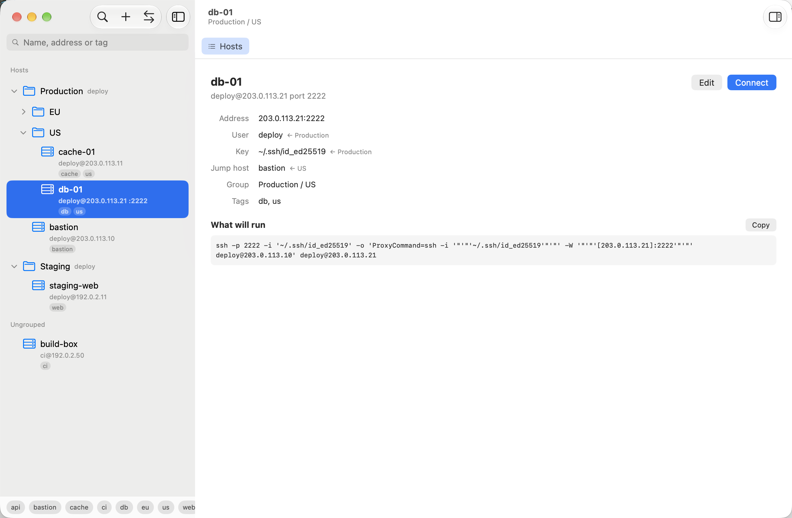

# Shellhand

A native macOS SSH client: the host list, tabs on real `ssh`, and files over
SFTP, in a window.

Shellhand keeps your machines in a list you can file into groups and find by
tag, opens each session as a tab running the system's own `ssh`, and browses
and moves files over SFTP.



## Install

Requires macOS 26. The build is universal, signed and notarized, and updates
itself from here.

Download the DMG from
[the latest release](https://github.com/cuonggt/shellhand/releases/latest),
or use Homebrew:

```sh
brew tap cuonggt/tap
brew trust --cask cuonggt/tap/shellhand
brew install --cask shellhand
```

The `brew trust` line is Homebrew's own doing, not this cask's: since Homebrew
7 a cask from a tap outside Homebrew's own has to be trusted once before it
will load, because a cask can carry install scripts. Read
[the cask](https://github.com/cuonggt/homebrew-tap/blob/master/Casks/shellhand.rb)
first if you would rather see what you are trusting — it is thirty-six lines
and carries no scripts at all.

Or build it yourself: `xcodegen generate` and then open the project, which is
what the licence is for.

## Status

Pre-release. No version is named here on purpose — the release page is the one
that cannot go stale. It updates itself through Sparkle, which has been
exercised from one release to the next rather than merely wired up.

This is cut back to an MVP: the host list and the editor, tabs, files over
SFTP, and import and export. Four things that were built have been taken out
again to get there — key management, credentials, snippets and port
forwarding. None of it is pending by accident; `CLAUDE.md` records what each
cut removed and what it cost.

The one thing to know before you try it: **Shellhand no longer answers a
password prompt.** A host that takes only a password still opens in a session,
because `ssh` asks on the pty where you can type it, exactly as in
Terminal.app — but Files cannot reach such a host, because an sftp child is
given `BatchMode=yes` and nothing is left to answer with. Key or agent
authentication works everywhere.

## What it does

- **A host list that inherits.** A host takes its own value first, then the
  nearest group above it that sets one. Groups pass down the user, the key,
  the jump host, ssh options, the agent and the terminal's colours, so
  production need not look like staging.
- **Tabs on real `ssh`.** Every session is `/usr/bin/ssh` on a pty, so your
  config, your jump hosts and your agent behave as they do in a terminal.
  Shellhand builds the argv — including a nested `ProxyCommand` that spells a
  jump chain out rather than handing ssh `-J` and losing each hop's port and
  key.
- **Files over SFTP**, in a window of its own that can sit beside a terminal,
  this Mac on the left and the host on the right, with transfers that queue a
  couple at a time rather than all starting at once and competing for the one
  connection — and a question before anything already there is replaced.
- **It knows what it is talking to.** On the first connection a host is asked
  what it is running — its own `/etc/os-release`, read over the connection
  rather than guessed from a banner — and from then on it is drawn with its
  distribution's mark. Asked again once a day, so a machine rebuilt onto
  something else corrects itself.
- **It says what your ssh config will do**, rather than leaving you to read it.
  A host whose name matches a `Host` entry pointing at a different machine is
  flagged as such, and one your config routes through a bastion says so
  instead of claiming it goes straight there.
- **Tags**, which cut across the group tree and narrow together — `web` and
  `eu` asks for the European web servers.
- **Import** from OpenSSH's own `~/.ssh/config`, a CSV, or Shellhand's own
  YAML, with a preview of exactly what it will do first. A fresh install lands
  on a welcome that counts the machines in your ssh config and offers them.
- **Export** the same YAML, which is plain text meant for a dotfiles
  repository: it names things rather than carrying ids, and holds no secrets.

## Requirements

macOS 26 or later. To build it: Xcode,
[XcodeGen](https://github.com/yonaskolb/XcodeGen) and Swift 6. Nothing to
configure and no server of its own — it drives the `ssh` already on your Mac.

## Building

```bash
xcodegen generate
xcodebuild build -project Shellhand.xcodeproj -scheme Shellhand \
  -configuration Debug -destination "platform=macOS" \
  -derivedDataPath build -skipPackagePluginValidation
```

`-skipPackagePluginValidation` is needed because SwiftTerm carries a build
plugin Xcode otherwise asks a human to trust.

`project.yml` signs with this project's Developer ID, so a build here sees what
a shipped build will see. Building without that certificate means overriding
`CODE_SIGN_IDENTITY` and `CODE_SIGN_STYLE` on the command line. Note that the
test bundle is hosted by the app, and a plug-in loaded into a hardened-runtime
app is refused at `dlopen` unless it shares the app's team — so running the
suite under another identity also means turning the hardened runtime off for
Debug.

```bash
xcodebuild test -project Shellhand.xcodeproj -scheme Shellhand \
  -configuration Debug -destination "platform=macOS" \
  -derivedDataPath build -skipPackagePluginValidation
```

The suite in `Tests/` covers the engine — inheritance, the argv, the merge, the
delete rules, SFTP's wire format and the conversation over it — against
OpenSSH's own `sftp-server` too — the `ssh` layer against a local `sshd`, the
transfer
queue, validation — and the rules lifted out of the layers above it: the group
tree, what a file pane shows, which tab is in front, what ⌘K offers for what
was typed, the sidebar's rows, whether ssh is waiting on a host key, and what a
session's state becomes given what is on its screen — the last two against a
real `ssh` prompt as well. It does not drive the
views themselves. `scripts/window-check.sh` is the one check that launches a
real window and walks its sidebar from outside; anything else above `Core/` is
judged by building it and using it.

## How it fits together

`Shellhand/Core/` is the engine: the store, the inheritance resolver, the argv
builder, the config, YAML and `ssh_config`, and SFTP. Everything above it —
`Model/`, `Terminal/`, `Views/` — goes through `Core`, an actor holding the
store connection and the sessions, runs and transfers that outlive the call
that started them. The host list is SQLite, through GRDB, at
`~/Library/Application Support/Shellhand/`.

`docs/` has the longer story: [architecture.md](docs/architecture.md) for the
shape and the traps worth knowing, and [app-icon.md](docs/app-icon.md) for
the icon.

`CLAUDE.md` is the working notes — every convention, and every trap found the
hard way. It is written for whoever touches the code next, which includes you.

## Licence

Copyright (C) 2026 Cuong Giang.

Shellhand is free software: you can redistribute it and/or modify it under the
terms of the GNU General Public License as published by the Free Software
Foundation, either version 3 of the License, or (at your option) any later
version. It is distributed in the hope that it will be useful, but WITHOUT ANY
WARRANTY; without even the implied warranty of MERCHANTABILITY or FITNESS FOR A
PARTICULAR PURPOSE. See the [GNU General Public License](LICENSE) for more
details.

Its dependencies are permissive and GPL-compatible: SwiftTerm, GRDB and Yams
are MIT, and SwiftTerm resolves `swift-argument-parser`, `swift-png` and `h` of
its own, which are Apache-2.0.

The distribution marks are composed from [Simple Icons](https://simpleicons.org),
whose files are CC0. That waives copyright and says nothing about trademarks:
each mark belongs to its project, and drawing one beside a server running that
distribution identifies the machine rather than claiming any endorsement. See
`tools/logos/README.md` before adding or reusing one.
